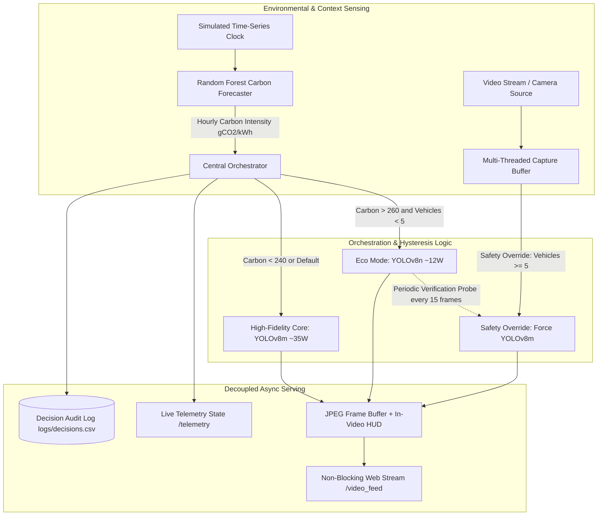

# ⚡ EcoStream: Explainable Carbon-Aware Runtime Orchestration for Edge Vision AI

[](https://www.python.org/downloads/)
[](LICENSE)
[](https://flask.palletsprojects.com/)
[](https://github.com/ultralytics/ultralytics)

**EcoStream** is an intelligent, carbon-responsive neural runtime orchestrator designed for edge video analytics. It continuously balances computational fidelity and power consumption by dynamically hot-swapping between high-accuracy computer vision backbones (**YOLOv8m**, ~35W nominal power) and low-power eco models (**YOLOv8n**, ~12W throttled power) in response to grid carbon intensity (gCO2/kWh) and safety-critical traffic density thresholds.

---

## 🏛️ System Architecture



---

## 🚀 Key Features & Engineering Fixes

1. **Zero-Lag Asynchronous Video Pipeline:** Decoupled background worker thread (`VideoStreamWorker`) decouples YOLO inference from HTTP client request loops. Web clients receive 30 FPS video streaming with zero duplicate inference overhead or dropped frames.
2. **Mathematical Hysteresis:** Prevents model chattering/flapping around threshold boundaries:
   - Enters Eco-Mode when carbon exceeds **260 gCO2/kWh** (`CARBON_HIGH`).
   - Exits Eco-Mode only when carbon drops below **240 gCO2/kWh** (`CARBON_LOW`).
3. **Safety-Critical Density Override:** Automatically forces the heavy core (YOLOv8m) when vehicle count $\ge 5$, ensuring zero object tracking dropouts during dense traffic.
4. **Periodic Heavy-Model Validation Probe:** When operating in Eco Mode, the nano backbone is periodically probed with the heavy core every 15 frames (`ECO_SAFETY_PROBE_INTERVAL`) to prevent undercounting safety gaps.
5. **Exact Feature Alignment:** Both Random Forest training and serving strictly enforce `['hour', 'day_of_week', 'month']`.
6. **Graceful Video Fallbacks:** Procedural test animation stream when no camera/video file is present, accompanied by an explicit `/fallback_frame` route.

---

## ⚙️ Project Structure

```text
EcoStream-Mjr-/
├── app.py                     # Main Flask web orchestrator & non-blocking streaming
├── main_controller.py         # Headless CLI controller with synchronized clock
├── config.py                  # Centralized configuration & thresholds
├── orchestrator.py            # Decision engine, hysteresis, and decision logging
├── generate_data.py           # Realistic diurnal & seasonal synthetic grid data
├── train_predictor.py         # Random Forest training with 80/20 time-series split
├── download_models.py         # Model downloader (YOLOv8m heavy, YOLOv8n light)
├── benchmark.py               # Latency & detection benchmark between models
├── requirements.txt           # Version-pinned dependencies
├── pytest.ini                 # Pytest testpath configuration
├── Dockerfile                 # Containerized deployment definition
├── references.md              # Academic literature citations
├── models/                    # Model weights (git-ignored)
│   ├── grid_predictor.pkl
│   ├── heavy_yolo.pt
│   └── light_yolo.pt
├── data/                      # Data assets (git-ignored)
│   ├── carbon_grid_data.csv
│   └── sample_video.mp4
├── logs/                      # Runtime decision logs & benchmark outputs (git-ignored)
│   └── decisions.csv
└── tests/                     # Unit & integration test suite
    ├── test_orchestrator.py
    └── test_app.py
```

---

## 🛠️ Setup & Execution Order

Follow these steps from a fresh clone:

### 1. Install Dependencies
```bash
pip install -r requirements.txt
```

### 2. Generate Grid Dataset
Generates 1 full year of hourly synthetic grid carbon intensity data:
```bash
python generate_data.py
```

### 3. Train Carbon Forecaster Model
Trains the Random Forest model on `['hour', 'day_of_week', 'month']` with time-based 80/20 holdout evaluation:
```bash
python train_predictor.py
```

### 4. Download Pre-trained Vision Models
Downloads YOLOv8m (Heavy Core) and YOLOv8n (Eco Core) into `models/`:
```bash
python download_models.py
```

### 5. Video Source Setup (Optional)
Place your target video file at:
```text
data/sample_video.mp4
```
*(Note: If no video file is provided, EcoStream automatically runs a built-in synthetic traffic animation stream for testing).*

### 6. Run the Application
Start the live web dashboard:
```bash
python app.py
```
Open **[http://127.0.0.1:5000](http://127.0.0.1:5000)** in your web browser.

To run the headless CLI controller:
```bash
python main_controller.py
```

---

## 🧪 Testing & Benchmarking

### Run the Test Suite
```bash
pytest -v
```

### Run Dual-Model Benchmark
Benchmarks latency and detection accuracy differences between YOLOv8m and YOLOv8n on `data/sample_video.mp4`:
```bash
python benchmark.py
```
Outputs report and writes `logs/benchmark_results.csv`.

---

## 🐳 Docker Deployment

Build and run using Docker:
```bash
docker build -t ecostream .
docker run -p 5000:5000 ecostream
```

---

## 🔬 Limitations & Experimental Notes

1. **Synthetic Grid Data:** Grid carbon intensity is modeled using synthetic diurnal curves (solar dips at midday, evening peaker surges, weekend reductions, and seasonal variations). In a production deployment, replace this with a real-time carbon grid API (e.g., ElectricityMaps API or National Grid ESO UK API).
2. **Estimated Power Consumption:** Power ratings (**35W** for YOLOv8m, **12W** for YOLOv8n) are representative thermal design profiles for edge devices (such as NVIDIA Jetson Orin Nano). For empirical hardware energy measurement, integrate `pynvml` or `jtop` hardware power sensors.

---

## 📚 Academic References

For academic context and related literature in carbon-aware federated computing and adaptive inference, see [references.md](references.md).
